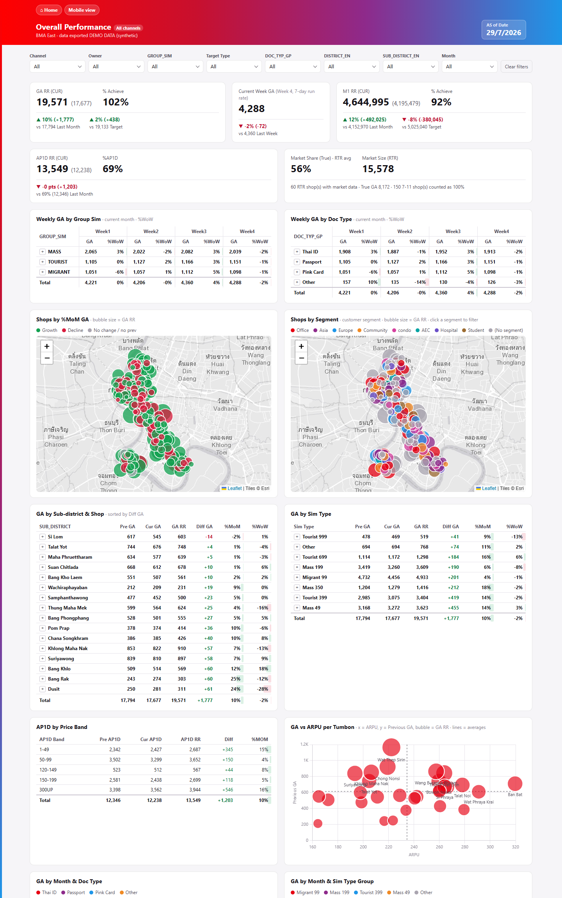
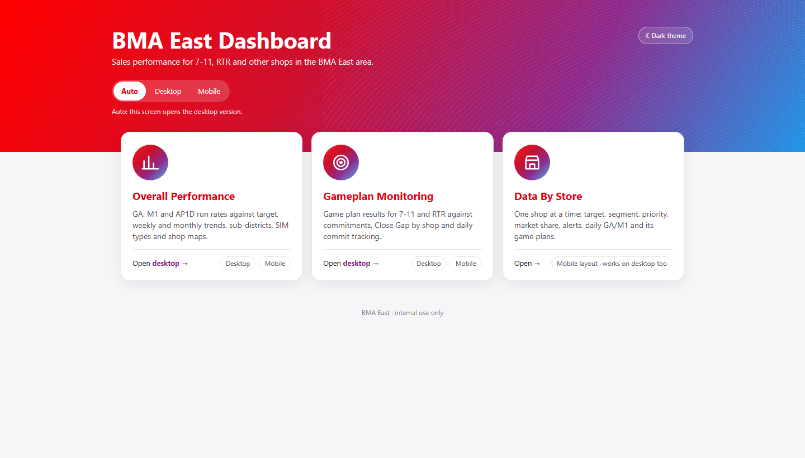
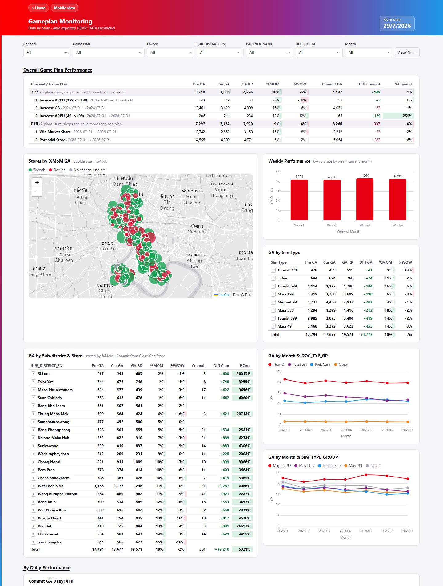
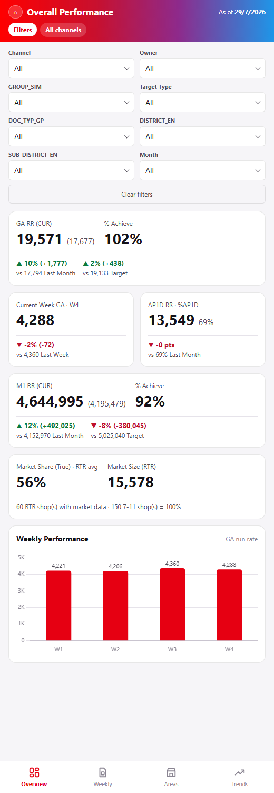
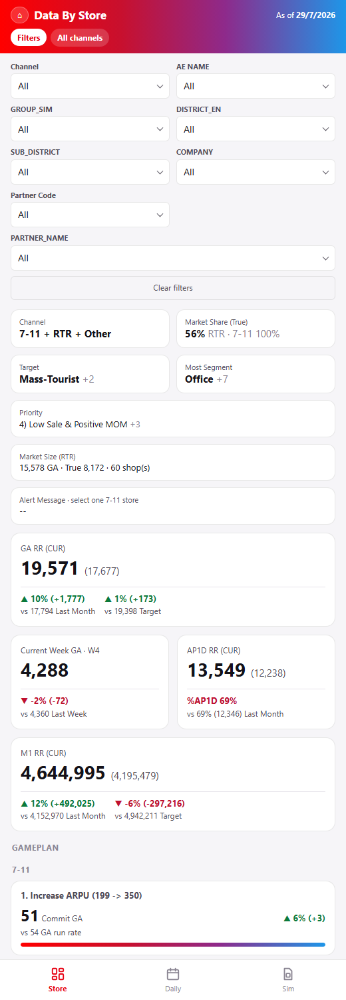
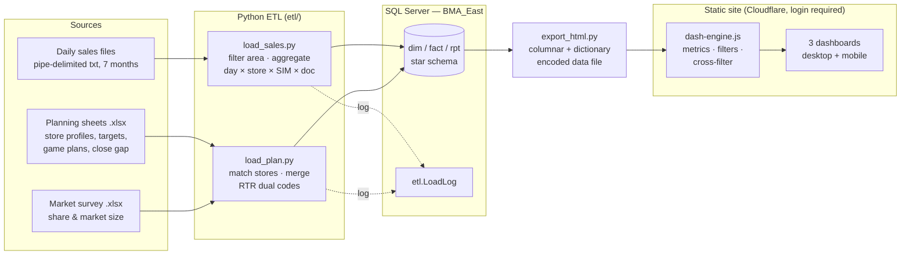

# BMA East Sales Monitoring Dashboard

> **Live demo: [https://autophuwit.github.io/sales-monitoring-dashboard/](https://autophuwit.github.io/sales-monitoring-dashboard/)** - runs on synthetic demo data from [etl/make_demo_data.py](etl/make_demo_data.py) (same format as the production export). Code, metrics, docs and the case study are from the production project; store names, owners, locations and numbers shown in the demo and screenshots are not real.

Web dashboards that give the BMA East sales team one view of **Modern Trade (7-11)** and **Retail (RTR)** sales —
by channel, area, store, SIM type and customer segment — on desktop and on mobile.

Raw sales files and planning sheets are loaded by a Python ETL into a **SQL Server star schema**, exported as one compact
data file, and every metric is calculated **in the browser**, so filtering and click-to-filter are instant and the
site is plain static files behind a login.

<p align="center"></p>

**Scale:** ~650 stores across 3 channels · ~96k aggregated daily sales rows over 7 months · 3 dashboards × desktop + mobile ·
one-command monthly update or an Airflow DAG · 25 automated tests.

## Impact

The dashboards are used to choose stores and customer segments, brief the sales team before store visits, and track
game plans daily. Results in the focus stores, May 2026 (plan month) vs. March 2026 (before the plans)
([full case study](docs/case-study/README.md)):

| Channel | Game plan | Result |
|---|---|---|
| 7-11 | Increase ARPU (199 → 350) | SIM 350 **+10%** |
| 7-11 | Increase ARPU (49 → 199) | SIM 199 **+15%** |
| 7-11 | Increase GA (tourist areas, low season) | Gross Add **+12%** |
| RTR | Win Market Share (stores losing to AIS) | Gross Add **+15%** |
| RTR | Potential Store (high-sales stores falling) | Gross Add **+13%** |

---

## Dashboards

### 1. Overall Performance
A complete view of channel health for the area.
- **Target tracking** – GA, M1 and AP1D run rate vs. target, % achievement and gap to target; vs. last month.
- **Weekly trends** – Week 1–4 GA by group SIM and by document type, with % WoW.
- **Daily tracking** – current vs. previous month by day, with the daily target line; GA by day of week.
- **Area view** – sub-district → store matrix sorted by change vs. last month, and a map of stores coloured by %MoM.
- **Segment view** – stores mapped by customer segment (Office, Asia, Europe, condo, …) to evaluate each segment.
- **Area strategy matrix** – sub-districts plotted on a 4-quadrant chart (ARPU × previous GA, bubble = GA run rate) with average lines, to pick area-specific actions.
- **Market share** – RTR share (True) and market size per store; AP1D by price band.

### 2. Gameplan Monitoring
Tracks the execution and effectiveness of sales game plans.
- Each plan's GA vs. commitment, % commit and gap — grouped by channel (7-11 / RTR) with plan dates.
- Store and sub-district level results against the **Close Gap** commitment.
- **SIM type breakdown** to pinpoint which product types are under-performing (plans 1 and 2 count only their target SIM group).
- **Daily tracking** against the daily commit, to surface early trends for in-flight adjustments.

### 3. Data By Store
A store-level view for frontline decisions.
- Priority group, target segment, most common customer segment, active game plans and their progress.
- **Relative performance vs. peers in the same zone** – an alert when a store's %MoM falls below the zone's weighted average minus one standard deviation.
- MoM comparison, target achievement (store target for 7-11, owner target for RTR), market share and market size.
- Daily GA / M1 vs. daily target, weekly run rate, and GA by SIM type and price band.

| Home | Gameplan (desktop) | Mobile |
|---|---|---|
|  |  |   |

### Works like a BI tool
- **Slicers** – multi-select with search; options cross-filter each other (pick an owner → only their stores).
- **Click-to-filter** – click a table row, map bubble, bar or chart line to filter the whole page. **Ctrl+click** adds more
  (OR within one visual, AND across visuals); the clicked visual stays complete and highlights the selection.
- **Period** – pick any month; earlier months are compared as complete months.
- **One link** – the home page opens the desktop or mobile layout automatically (can be overridden and is remembered).

---

## Architecture



| Layer | What it does | Where |
|---|---|---|
| **Ingest** | Reads large monthly files in chunks by column name, keeps the 8 area districts, aggregates to day × store × SIM × doc type. Skips files that have not changed. | [etl/load_sales.py](etl/load_sales.py) |
| **Master & plan data** | Loads store profiles for both channels, owner/store targets, game plans, close gap and market share; merges RTR stores that have two partner codes into one outlet; writes unmatched names to a log. | [etl/load_plan.py](etl/load_plan.py) |
| **Storage** | Star schema in SQL Server Express, idempotent month-replace loads in one transaction, guarded so an empty or partial file never replaces a loaded month, load log. | [sql/](sql/) · [docs/data-model.md](docs/data-model.md) |
| **Serve** | Exports one compact file (columnar arrays + dictionary encoding). | [etl/export_html.py](etl/export_html.py) |
| **Compute & UI** | Re-calculates every metric in the browser on each filter change; Chart.js charts, Leaflet maps. | [assets/](assets/) |
| **Schedule** | `update.ps1` for a manual run, or the Airflow DAG: waits for the sales file, retries, alerts on failure, backfills past months. | [dags/](dags/bma_east_update.py) |
| **Deploy** | Push to GitHub → Cloudflare deploys the static site; Cloudflare Access (email one-time PIN) restricts who can open it. | [update.ps1](update.ps1) |

---

## Key design decisions

- **One outlet model for two channels.** 7-11 stores have one partner code; many RTR stores have two (True and Dtac).
  `dim.Store` (partner code) maps to `dim.Outlet` (the physical shop), so sales, targets and plans for both codes roll up to
  one store and both channels share every table and page, with a Channel filter instead of separate reports.
- **Idempotent, auditable loads.** Each month is deleted and re-inserted in one transaction; re-running is always safe.
  Before anything is deleted, the new data is checked: an empty file, or one with less than half the rows already loaded,
  stops the load and the month keeps its data. Rows dated in another month are not loaded, so they cannot be duplicated.
  Every load is recorded in `etl.LoadLog` (file, size, modified time, rows, status), which is also how unchanged files are skipped.
- **Metrics in the browser.** The site needs no server or database connection. The data file is a pre-aggregated
  daily snapshot (~7 MB), so all filters and cross-filters re-compute instantly on the client.
- **Business rules in one place.** Run rate, week normalisation, game plan SIM rules, targets and alerts live in
  [assets/dash-engine.js](assets/dash-engine.js) and are covered by unit tests — see [docs/metrics.md](docs/metrics.md).

## Documentation

| | |
|---|---|
| [docs/case-study/](docs/case-study/README.md) | How the dashboards drive the game plans, and their results |
| [docs/data-model.md](docs/data-model.md) | ERD and design of the star schema |
| [docs/etl-pipeline.md](docs/etl-pipeline.md) | Sources, load steps, idempotency, logging |
| [docs/data-quality.md](docs/data-quality.md) | Checks and how each issue is handled |
| [docs/data-dictionary.md](docs/data-dictionary.md) | Tables and columns |
| [docs/metrics.md](docs/metrics.md) | Definition of every metric |
| [docs/user-guide.md](docs/user-guide.md) | What each dashboard answers and how to filter |

---

## Run it

**Requirements:** Windows, SQL Server Express (`localhost\SQLEXPRESS`), ODBC Driver 17/18 for SQL Server, Python 3.10+, Git.

```powershell
pip install -r requirements.txt

# once: create the database (run in SSMS or sqlcmd, in order)
sql/01_create_database.sql
sql/02_prepare_load.sql
sql/03_channel_model.sql

# every update (load sales -> load plans -> export -> publish)
.\update.ps1                    # this month
.\update.ps1 -Month 202608      # a given month
.\update.ps1 -SkipPlan          # sales only
.\update.ps1 -NoPush            # update locally, then open index.html
```

**Scheduled (Airflow):** copy [dags/bma_east_update.py](dags/bma_east_update.py) to the Airflow `dags/` folder and set
`BMA_HOME`, `BMA_SALES_DIR` and `BMA_ALERT_TO`. Runs daily at 08:00; re-load past months with
`airflow dags backfill -s 2026-05-01 -e 2026-07-31 bma_east_update`.

**Try it without a database:** generate synthetic demo data, then open `index.html`.
```powershell
python etl/make_demo_data.py --out data/dashboard-data.js
```

## Tests

```powershell
python -m unittest discover -s tests -v   # ETL: cell cleaning, area filter, aggregation, bad codes, replace guard
node --test tests/                        # metrics: run rate, MoM, WoW, period, filters, targets, alerts
```
Both run on every push via GitHub Actions ([.github/workflows/tests.yml](.github/workflows/tests.yml)).

## Project structure

```
index.html, *.html     dashboards (desktop + mobile) and home page
assets/                dash-engine.js (metrics, filters), page logic, styles
data/                  dashboard-data.js (exported snapshot)
etl/                   Python loaders and export
dags/                  Airflow DAG (scheduled version of update.ps1)
sql/                   database build scripts
tests/                 Python + JavaScript unit tests
docs/                  documentation and screenshots
update.ps1             one-command update and publish
```

**Tech:** Python (pandas, openpyxl, pyodbc) · SQL Server / T-SQL · JavaScript · Chart.js · Leaflet · Airflow · GitHub Actions · Cloudflare
