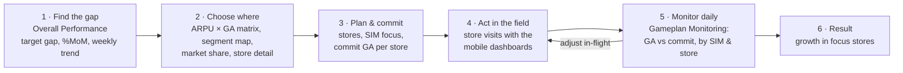
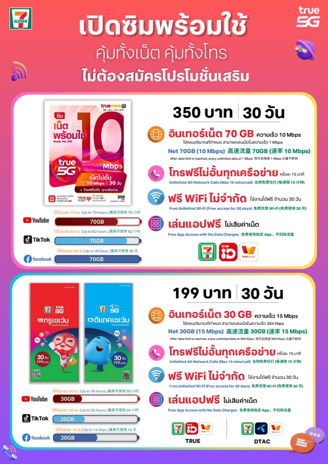
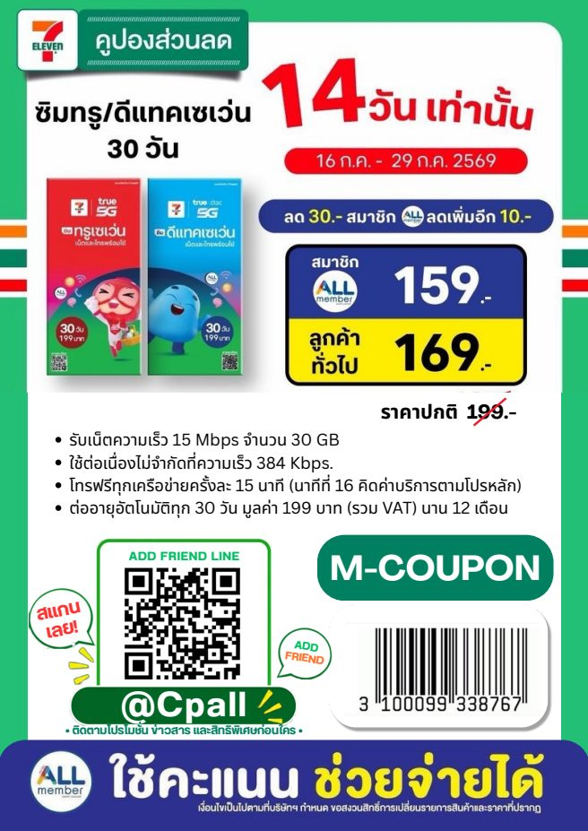
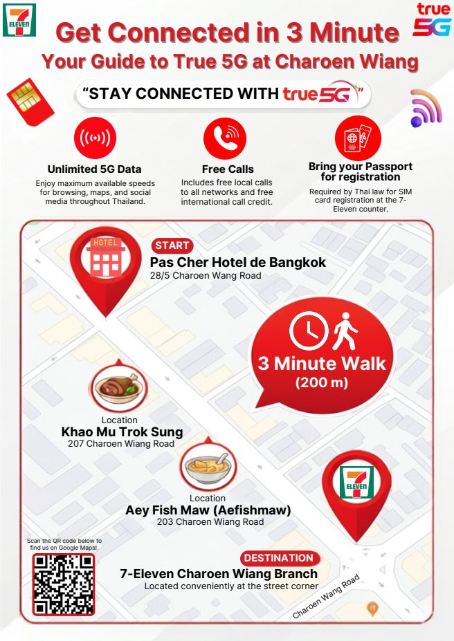

# From dashboard to sales — Game plan case study

> *"We built a dashboard. Did it create sales? Does the sales team know where to focus?"*

This case study closes that question. The dashboards were used to **find the gap, choose the stores and customer
segments, guide the store visits and track every plan daily**. Five game plans — three for 7-11 and two for RTR — are
the same plans shown in [Gameplan Monitoring](../../Gameplan%20Monitoring%20Desktop.html).

**How results are measured:** sales of the focus stores in **May 2026** (the month the plans ran) compared with
**March 2026** (before the plans), on the SIMs each plan targets.

| Channel | Game plan | Focus | Result (May vs. March 2026) |
|---|---|---|---|
| 7-11 | [1. Increase ARPU (199 → 350)](#1-increase-arpu-199--350) | 9 stores | **+10%** average growth of SIM 350 |
| 7-11 | [2. Increase ARPU (49 → 199)](#2-increase-arpu-49--199) | 10 stores | **+15%** average growth of SIM 199 |
| 7-11 | [3. Increase GA](#3-increase-ga) | 11 stores | **+12%** Gross Add in focus areas |
| RTR | [1. Win Market Share](#1-win-market-share) | stores losing to AIS | **+15%** Gross Add in focus stores |
| RTR | [2. Potential Store](#2-potential-store) | 24 stores | **+13%** Gross Add in focus stores |

---

## How the dashboards drive the plans

| Step | Dashboard | What it answers |
|---|---|---|
| Find the gap | **Overall Performance** | Which channel, area and SIM group is behind target or falling vs. last month / last week? |
| Choose where | **Overall Performance** – ARPU × GA quadrant, Shops by Segment map · **Data By Store** – market share, segment, priority | Which sub-districts and stores have the right customers and the most room to grow? |
| Plan & commit | **Data By Store** – store target, recent trend | How much can each store realistically commit? |
| Act | **Data By Store (mobile)** during visits | Before walking in: is this store up or down, which SIM types, is there an alert vs. zone peers? |
| Monitor | **Gameplan Monitoring** (desktop + mobile) | Is each plan on track vs. its commit — daily, by store, by SIM type? Which stores need a second visit? |

Each plan is measured on the right SIMs: plan 1 counts only **Mass 350** SIMs, plan 2 only **Mass 199** SIMs, the
others count all SIMs (see [metrics](../metrics.md#game-plans)).

---

## 7-11

### 1. Increase ARPU (199 → 350)

**Customer segment & pain point**
- **Foreign long-stay customers (≈30 days)** — Chinese, Indian and other Asian customers on a modest budget who look for a cheap SIM.
- **Thai customers with spending power** who stream series and video and need a lot of data, but do not want a monthly contract.
- In both cases **store staff did not know which SIM to recommend**, so they sold the 199 SIM instead of the 350 SIM.

**Plan** — Select the stores where these customers are, using the **ARPU × GA matrix** to pick the areas, and set a
target per store based on its capacity. *9 stores.*

**Action points**
1. **Value comparison material: 199 vs. 350** (70 GB vs. 30 GB for 30 days, hours of YouTube / TikTok) so staff can recommend the 350 SIM in seconds.
2. **Coaching at the store** — which customers to target and how to pitch.
3. **Commit per store** — staff see how many SIMs they need to sell; stores that reach the commit earn a reward.

**Result** — More customers moved from 199 to 350: **SIM 350 sales grew 10% on average**.

---

### 2. Increase ARPU (49 → 199)

**Customer segment & pain point**
- **Price-driven Thai customers** who buy the cheapest SIM without knowing the 49 SIM has very little data — they end up topping up or buying another SIM.
- **Students** who need internet on a limited budget.

**Plan** — Select the stores where these customers are, using the **ARPU × GA matrix**, and set a target per store. *10 stores.*

**Action points**
1. **Promotion material: SIM 199 for 159** (coupon, 14 days) to close the price gap with the 49 SIM.
2. **Coaching at the store** — target customers and selling technique.
3. **Commit per store** with a reward for reaching it.

**Result** — More customers moved from 49 to 199: **SIM 199 sales grew 15% on average**.

---

### 3. Increase GA

**Customer segment & pain point** — Areas that already sell high-ARPU SIMs, mainly to **European and other foreign
tourists**. In the **low season** fewer tourists came, so sales dropped.

**Plan** — Focus on the stores in these tourist areas (ARPU × GA matrix: high ARPU, GA falling) and set a target per store. *11 stores.*

**Action points**
1. **"Get connected in 3 minutes" guides** that show the walk from nearby **hotels and restaurants popular with foreigners** to the 7-11 store, placed in those hotels and restaurants.
2. **Commit per store** with a reward for reaching it.

**Result** — **Gross Add grew 12%** in the focus areas.

---

## RTR

### 1. Win Market Share

**Customer segment & pain point** — Customers did not fall; they **bought from AIS instead**. Mostly Thai customers
who trust AIS more.

**Plan** — Focus on stores that sell more AIS than True, or are trending that way (market survey: in **17 of 112**
surveyed stores AIS already outsold True), and set a target per store. Market share and market size per store are in
the dashboards.

**Action points**
1. **Study the competitor** — AIS promotions and why stores prefer to sell AIS — and run campaigns that give stores a reason to switch to us.
2. **Visit more often** to build the relationship between our sales team and the store owner, so the store wants to sell our SIMs.

**Result** — **Gross Add grew 15%** in the focus stores.

---

### 2. Potential Store

**Customer segment & pain point** — Large, high-selling stores with a strong customer base (mainly **migrant (AEC)
workers and foreigners**) and a good relationship with our sales team, but sales were **falling or flat**. The cause:
customers arrive at the same time and the store **cannot serve them fast enough or runs out of stock** at peak time.

**Plan** — Focus on high-sales stores whose sales are falling, and set a target per store. *24 stores.*

**Action points**
1. **Booth or extra hands at peak time** — our team helps the store sell when customers arrive together.
2. **Stock monitoring** so the store never runs out during peaks.
3. **Commit per store** with a reward for reaching it.

**Result** — **Gross Add grew 13%** in the focus stores.

---

## What made it work

- **One view for analysis and for the field.** The same numbers are used to choose stores at the desk and to brief the sales team on the phone before a visit.
- **Plans measured the way they are sold.** ARPU plans count only their target SIM, so a plan cannot look good on the wrong product.
- **Daily feedback.** Gameplan Monitoring shows GA vs. commit every day, so weak stores get a second visit while the plan is still running, not after the month ends.
