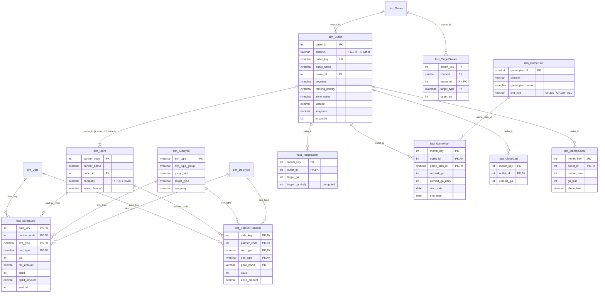

# Data model

Database **BMA_East** on SQL Server Express. Star schema in four schemas:

| Schema | Holds |
|---|---|
| `dim` | descriptive tables: date, outlet (shop), partner code, owner, SIM type, document type, game plan |
| `fact` | measurable events: daily sales, AP1D by price band, targets, game plan commitments, close gap, market share |
| `rpt` | read-only views for exports and reports |
| `etl` | load log and mapping tables used by the loaders |

Built by [sql/01_create_database.sql](../sql/01_create_database.sql), [02_prepare_load.sql](../sql/02_prepare_load.sql) and
[03_channel_model.sql](../sql/03_channel_model.sql) (run once, in order).

## ERD

`dim.Date`, `dim.Owner` and `dim.DocType` are omitted from the diagram body for space — see the [data dictionary](data-dictionary.md).

## Design decisions

**Grain of the sales fact.** One row per **day × partner code × SIM type × document type**. This is the lowest level any
dashboard needs (daily charts, SIM and document breakdowns, store detail), and it shrinks the raw transaction files to
~96k rows for 7 months.

**Outlet vs. partner code.** Sales arrive by *partner code*. A 7-11 store has one code; many RTR stores have two (one per
operator, True and Dtac). Facts stay at partner-code grain (as delivered), and `dim.Store.outlet_id` maps each code to
one `dim.Outlet` — the physical shop that owns the profile, owner, location, targets and game plans. Every report
aggregates by outlet, so a dual-code RTR shop is counted once everywhere.
`outlet_key` (`7-11:<code>`, `RTR:<first code>`, `Other:<code>`) keeps the outlet stable across reloads.

**Three channels in the same tables.** `dim.Outlet.channel` is `7-11`, `RTR` or `Other` (codes in the area that are in
neither profile, so no sales are lost). Targets, game plans and plans' SIM rules carry the channel, so one set of tables
and one dashboard per topic serves both channels with a Channel filter.

**Monthly planning facts.** Targets, game plans, close gap and market share are keyed by `month_key` and replaced per
month, which keeps history and makes re-loads idempotent.

**Business rules as data.** SIM type → group mapping lives in `etl.SimTypeGroupMap`; each game plan's SIM rule
(`GP350` = Mass 350 SIMs only, `GP199` = Mass 199 only, `ALL`) lives in `dim.GamePlan.sim_rule` — not in code.

**Computed columns.** `fact.TargetStore.target_ga_daily = CEILING(target_ga / 30)` is persisted, so every consumer uses
the same daily target.

## Views (`rpt`)

| View | Purpose |
|---|---|
| `rpt.AsOf` | as-of date (latest sales day), current / previous month, run-rate day (as-of day − 1), current week |
| `rpt.DateFlags` | `dim.Date` plus current / previous month flags |
| `rpt.StoreOutlet` | partner code → outlet → channel, owner, location (convenience join) |
| `rpt.OutletMarketShare` | latest market share per outlet; 7-11 outlets = 100% |
