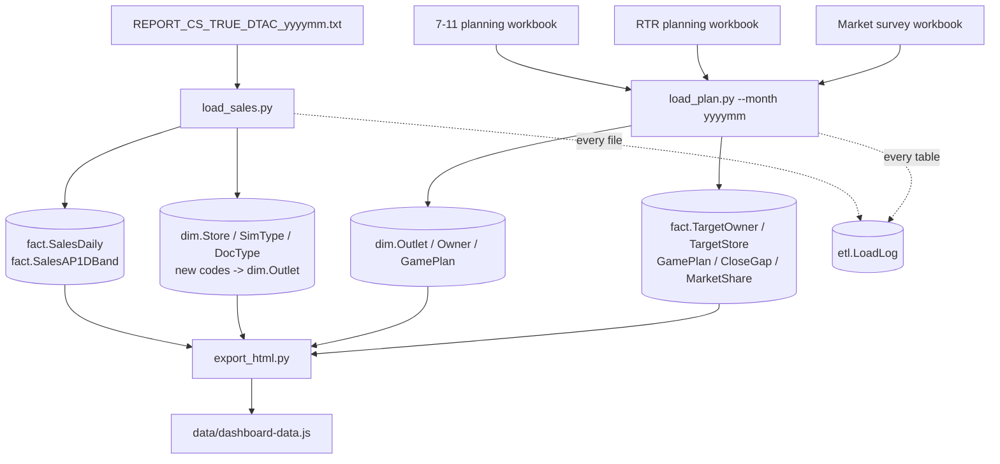

# ETL pipeline

Run all steps with **`.\update.ps1`** ([update.ps1](../update.ps1)); it stops at the first failure so a broken load is never published.

## 1. Sales — [etl/load_sales.py](../etl/load_sales.py)

| | |
|---|---|
| Source | monthly pipe-delimited text files, Thai Windows-874 encoding, one file per month |
| Read | in chunks of 400k rows, **by column name** (column order changes do not break it); stops with a clear error if a needed column is missing |
| Filter | `TDS_PROVINCE` = the 8 districts of the area |
| Clean | trims text, converts codes / dates / numbers; rows with a non-numeric or out-of-range partner code or date are dropped and counted |
| Aggregate | sums GA, M1 revenue, AP1D and the 16 AP1D price-band columns per day × partner code × SIM type × doc type |
| New members | adds unseen doc types, SIM types (group from `etl.SimTypeGroupMap`, else `Other`) and partner codes; a code with no shop gets a new outlet (`7-11` if the file says so, else `Other`) |
| Write | **deletes the month and inserts it again in one transaction** — re-running gives the same result |
| Incremental | skips a file whose size and modified time match its last successful load in `etl.LoadLog`; `--force` reloads all, `--only yyyymm` one month |

## 2. Plans and master data — [etl/load_plan.py](../etl/load_plan.py)

Finds the two downloaded workbooks by their **tab names** (not file names) and loads, for `--month`:

| Step | From | To |
|---|---|---|
| Store profile 7-11 | Store Profile | `dim.Outlet` (owner, segment, priority, zone, location), `dim.Store` link |
| Store profile RTR | RTR Store Profile (True / Dtac code columns) | one `dim.Outlet` per shop, both codes linked |
| Retail names | Retail Name | RTR display names |
| Owner targets | Target By AE Name / RTR Target By AE Name | `fact.TargetOwner` (per channel, target type) |
| Store targets | Target All Type | `fact.TargetStore` |
| Game plans | Game Plan / RTR Gameplan | `dim.GamePlan` (new RTR plans added, rule `ALL`), `fact.GamePlan` |
| Close gap | Close Gap Store | `fact.CloseGap` |
| Market share | market survey sheet | `fact.MarketShare` |
| Finish | — | flag RTR outlets no longer in the profile; remove orphan outlets |

Month-based tables are replaced for that month. Names that cannot be matched to a store are written to
`logs/unmatched_<month>.csv` for follow-up instead of being dropped silently.

## 3. Export — [etl/export_html.py](../etl/export_html.py)

Reads the model and writes `data/dashboard-data.js`:
- **Columnar arrays** (one array per column) instead of row objects.
- **Dictionary encoding** — repeated text (SIM types, districts, document types…) stored once and referenced by number.
- Outlets carry their attributes once; facts reference outlets by index.
- Planning tables use the current month, or the latest earlier month that has data.

The result (~7 MB for 7 months) loads once; all metrics are then computed in the browser.

## Logging

Every load writes a row to `etl.LoadLog`: target table, source file, month, file size and modified time, rows loaded,
status (`started` / `success` / `failed`), message, start and finish time. A failed load rolls back its transaction and
records the error. The scripts print **counts only**, never data values.
